

# MoneyAngle

**Your bank statement, seen from every angle.**

Import a bank statement and get private, encrypted dashboards, AI categorisation and answers in plain language. 
The AI runs on your own computer, and the server can't read your data without your password.

  

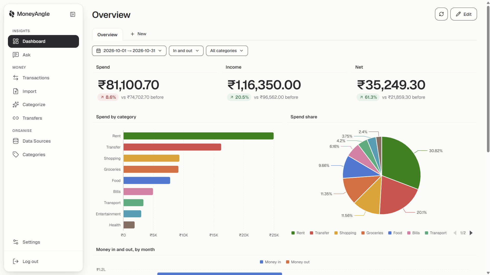

## Highlights

- **Zero-access encryption at rest.** Amounts, names, dates, notes, categories and dashboard titles are encrypted with AES-256-GCM, under a key that only the user's password or recovery key can open. A full copy of the database plus every server secret still can't read a single transaction.
- **Bring-your-own AI.** Categorisation, retrieval-augmented Q&A and a LangGraph agent all use the user's own Ollama, called from the browser. The server never calls a model, and no data goes to an AI company.
- **A dashboard builder on encrypted data.** KPIs, bar, pie, area and heatmap panels, calculated fields, filters and drill-down. Aggregation runs in Python after decryption, because SQL can't sum encrypted amounts.
- **Real-world imports.** Excel (including password-protected files), old `.xls`, CSV, and PDF (parsed in the browser). Column headers are detected automatically, and re-importing never creates duplicates.
- **Built like production.** Docker, a GitHub Actions pipeline (test, migrate, deploy), CSP, CSRF and origin checks, per-account login limits, and a published [privacy policy](https://moneyangle.vercel.app/privacy).

## The AI pages

| Ask your transactions | Categorize with AI |
| :---: | :---: |
| 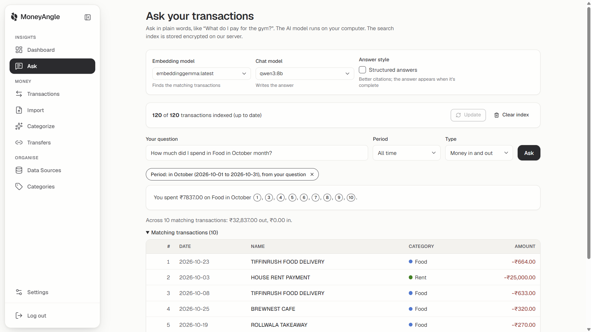 | 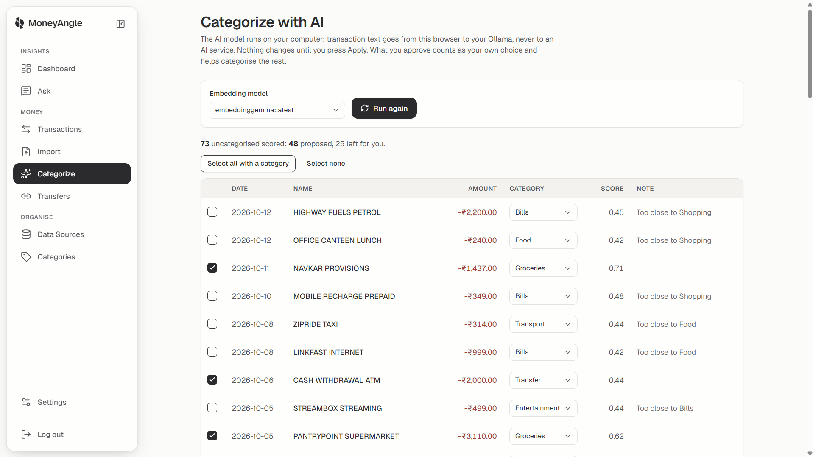 |
| A question becomes a hybrid search (keywords and vectors, fused with RRF) over an encrypted index. A local model then writes an answer that cites the matching rows. | Each transaction is compared with examples from your own categories. Only confident matches are proposed, and nothing changes until you approve. |

## Walkthrough: from sign-up to deletion

**1. Sign up.** Email, password and date of birth (18+ only), plus consent to the privacy policy. The account gets its own encryption key, and the app shows a recovery key once: it's the only way back if the password is forgotten.

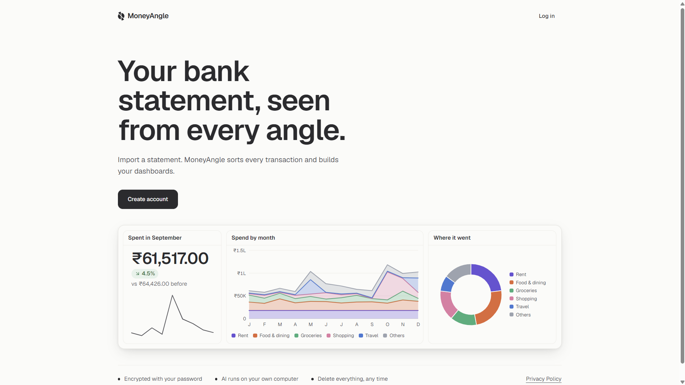 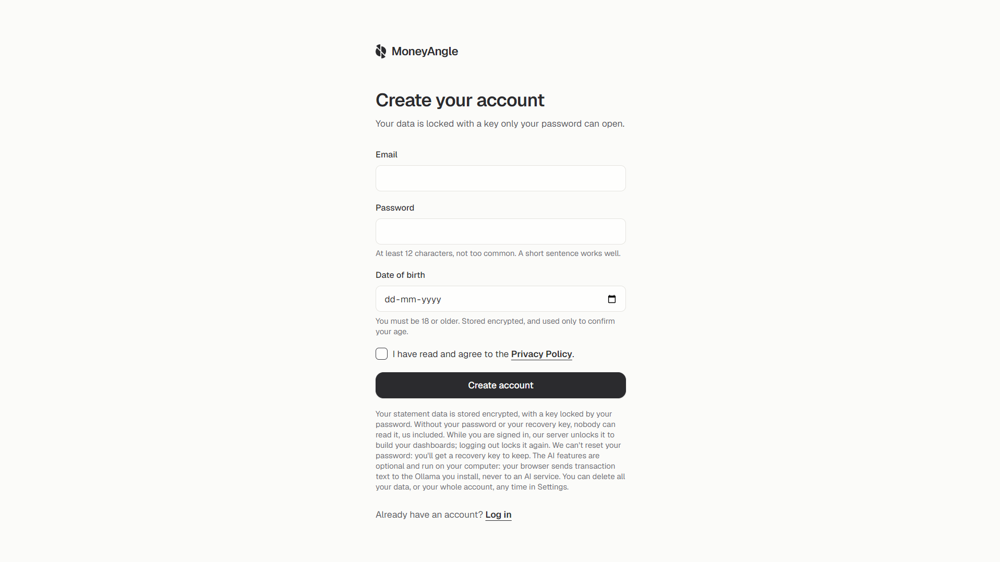

**2. Import a statement.** Pick a file and a data source (one per bank account). The column mapping is detected and can be corrected, and you see a preview before anything is saved. The file itself is never stored.

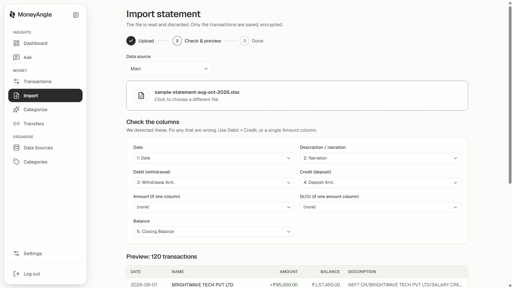

**3. Connect your AI (once).** Install Ollama, pull two small models and allow the site. After that, the browser talks to `localhost` directly.

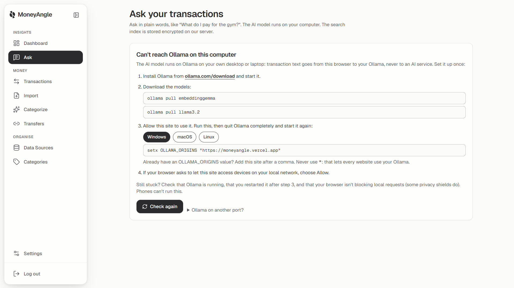

**4. Categorise.** Run **Categorize** (shown above) and approve the proposals. Keywords on each category teach the AI your own vocabulary.

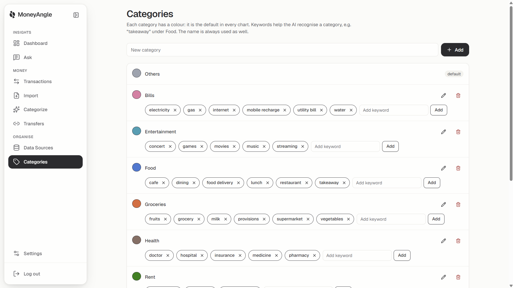

**5. Explore.** Dashboards (top of this page) update with every import. **Ask** answers questions like *"How much did I spend on food in October?"*.

**6. Own your data.** Download an encrypted backup, delete all data, or delete the account. Deleting the account destroys the key, so even old backups can no longer be opened.

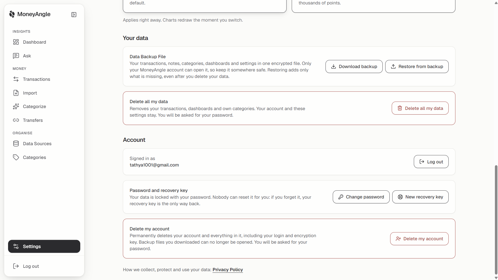

## How it works

### Architecture

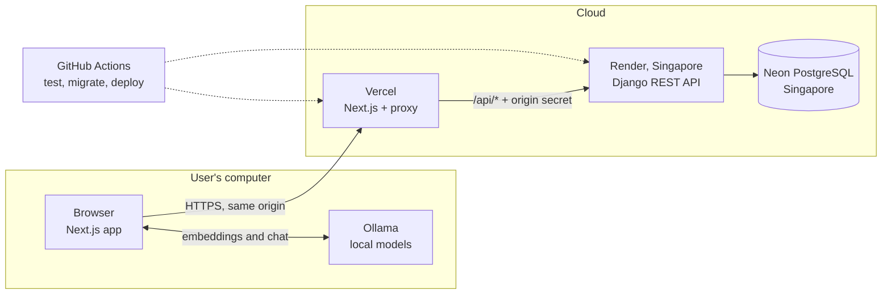

- The browser only ever talks to one origin. The Next.js proxy forwards `/api/*` to Django with a shared secret, so the API refuses requests that skip the site, and no CORS is needed.
- AI calls go from the browser to `localhost:11434`. The server prepares the work and stores only encrypted results, such as search vectors.

### Database layout

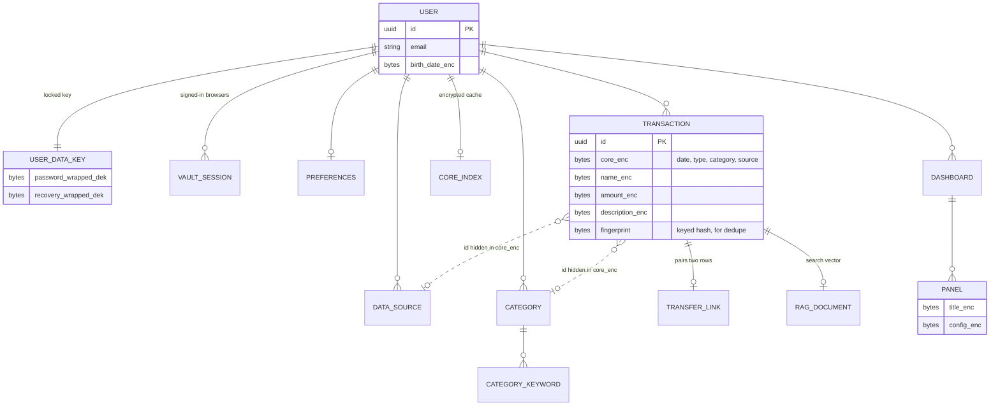

`_enc` columns are AES-256-GCM ciphertext. Even a transaction's date and category are encrypted, so the database can't tell which category a row belongs to. Lookups that need equality, such as duplicate detection on re-import, use keyed hashes (blind indexes) instead of plaintext.

### Encryption

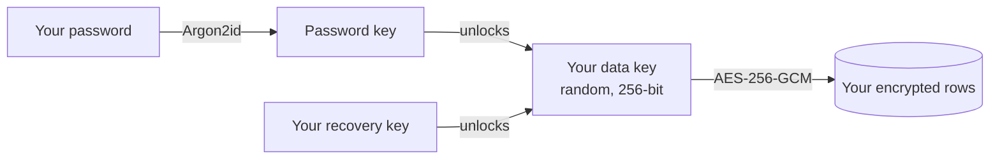

1. Each account gets its own random **data key**. Everything sensitive is encrypted with it.
2. The data key is stored only in **locked** form: once with a key derived from your password, and once with your recovery key. Neither the password nor the recovery key is stored, so nobody, including the operator, can unlock it.
3. Each ciphertext is bound to its owner and column, so it can't be copied to another user's row or another field.
4. Changing the password re-locks the same key, so no data is re-encrypted. A recovery replaces the recovery key with a new one.

### How a session works

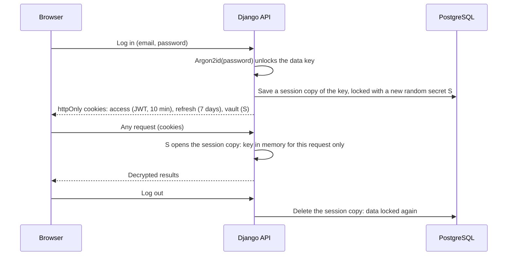

- The secret that opens a session lives **only** in the browser's `vault` cookie. The database holds just the locked copy.
- Access tokens last 10 minutes. Refresh tokens rotate on every use, and old ones are blacklisted. A login is renewed only while its vault session is still valid.
- Cookies are `httpOnly`, `Secure` and `SameSite=Lax`, with a CSRF token and an Origin check on every write. Logins are rate-limited per IP address and per account.
- Changing the password signs out every other browser. Deleting the account removes the key, every row and every session.

## Tech stack

| Layer | Technology |
| --- | --- |
| Frontend | Next.js 16 (App Router), React 19, TypeScript, Tailwind CSS 4, ECharts 6, pdf.js |
| Backend | Python 3.11, Django 5.2, Django REST Framework, SimpleJWT, Gunicorn |
| Security | AES-256-GCM, Argon2id, HMAC blind indexes, CSP, CSRF |
| AI | Ollama (local), LangGraph agent, hybrid RAG (keyword + vector, RRF) |
| Data | PostgreSQL 16 |
| Infrastructure | Docker Compose, GitHub Actions, Vercel, Render, Neon |

## License

[MIT](LICENSE)
